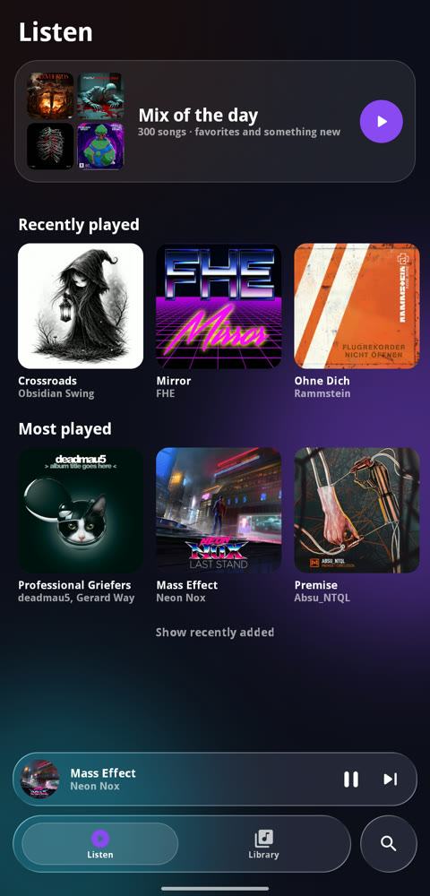
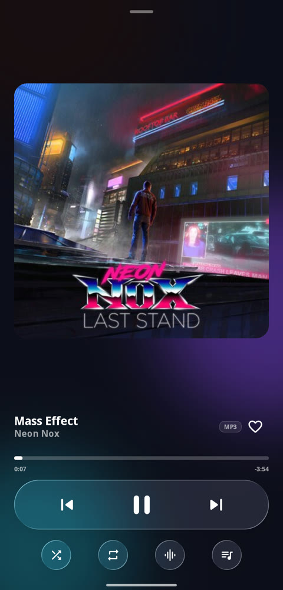
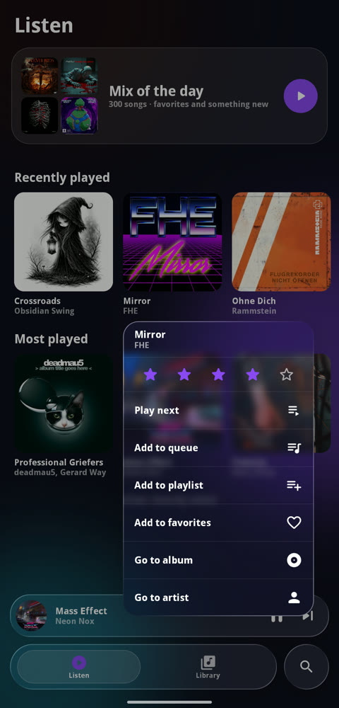
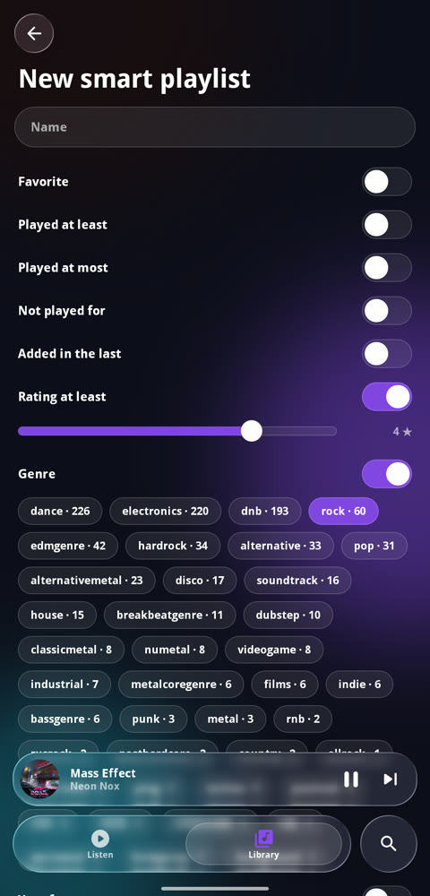
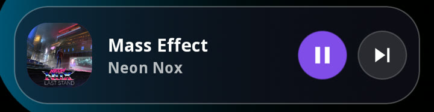

# Notile

An Android music player with a liquid-glass look. It plays the music stored on your phone: offline, no accounts, no ads. Available in English and Russian (follows the system language).

<p align="center">
  
  
  
  
</p>
<p align="center">
  
</p>

## Features

- **Library**: albums, artists, songs, folders and search. Covers, genre and year come from the file tags.
- **Listen**: a "Mix of the day" (one set per day), shelves for recently played, most played and forgotten songs, and recently added albums (can be hidden).
- **Smart playlists**: built automatically from rules: favorite, play count, not played for N days, added recently, rating, genre, year. For example, "rock from the 90s".
- **Song ratings** (stars), favorites, regular playlists, and pinning playlists to the home screen.
- **Multiple queues**: park the current queue and come back to it later from the same position.
- **Long-press menus** in an Apple-like glass style for songs, playlists and queues.
- **Cover-driven colors**: the accent color follows the album that is playing.
- **Sound**: equalizer with presets, smooth fades between tracks, sleep timer.
- **Home-screen widget** in three sizes, with colors that follow the cover.
- Notification, lock-screen and headset controls (Media3).

The app only needs access to audio files and permission to show notifications. It has no internet permission.

## Adding your music

Notile does not download or import anything: it plays audio files that are already on your phone and known to Android's media library.

1. Copy your music to the phone, for example over USB (set the connection to "File transfer") or by downloading files. Put it in the `Music` folder, or any other regular folder. Ringtones, notifications and alarms are ignored.
2. Open Notile. The library refreshes every time you come back to the app. If a new file does not show up, give Android a minute to scan it, or restart the phone. Folders that contain a `.nomedia` file are skipped by Android.
3. Make sure the files have tags (title, artist, album, genre, year, cover art). Notile reads them for the library, covers, and smart playlists. Files without tags still play, but appear as "Untitled" or "Unknown artist".

Anything Android can play works, such as MP3, FLAC, AAC/M4A, OGG/Opus and WAV. Streaming services are not supported.

## Languages

English and Russian. Notile follows the system language; on Android 13 and newer you can also set it per app in Settings → Apps → Notile → Language.

## Install the ready-made APK

1. Download `notile-0.1.apk` from the [Releases](../../releases) page.
2. Open the file on your phone and allow installation from this source.
3. On first launch, grant access to your music.

Requires Android 13 or newer. The APK is signed with the standard Android debug key: this is a personal build, not meant for an app store.

## Build it yourself

You need:

- JDK 17 or newer;
- Android SDK with platform 37 (the easiest way is to install Android Studio);
- an internet connection for the first build, so Gradle can download dependencies.

```bash
git clone https://github.com/MarkSheinDes/Notile.git
cd Notile
echo "sdk.dir=/path/to/Android/Sdk" > local.properties   # Windows: sdk.dir=C:/Users/NAME/AppData/Local/Android/Sdk
./gradlew :app:assembleRelease                           # Windows: gradlew.bat :app:assembleRelease
```

The result is `app/build/outputs/apk/release/app-release.apk`. A debug build (`:app:assembleDebug`) is noticeably slower and the interface will stutter, so judge smoothness on a release build.

Install on a connected phone (USB debugging enabled):

```bash
adb install -r app/build/outputs/apk/release/app-release.apk
```

Logic tests (favorites, playlists, smart playlists, parked queues, mix of the day, shuffle order):

```bash
./gradlew :app:testDebugUnitTest
```

## Project layout

A single `app` module, package `app.notile`:

| File | What it does |
| --- | --- |
| `Library.kt` | reads music from MediaStore, groups it into albums and artists |
| `Store.kt`, `Smart.kt` | user data (one JSON file), smart playlists and their rules |
| `PlaybackService.kt`, `PlayerHub.kt`, `NextUpShuffleOrder.kt`, `Sound.kt` | playback, queues, shuffle, equalizer, fades, sleep timer |
| `Screens.kt`, `NowPlaying.kt`, `ItemMenu.kt`, `SongMenu.kt`, `Ui.kt` | screens and the glass UI elements, built with Jetpack Compose |
| `NotileWidget.kt` | the home-screen widget |

User data stays on the phone, in `notile.json` inside the app's private storage.

## Roadmap

- A desktop version.
- True crossfade with overlapping tracks (currently a fade out and fade in).

## License

[MIT](LICENSE). The app uses Jetpack Compose, Media3, [backdrop](https://github.com/Kyant0/AndroidLiquidGlass) (glass effect) and [reorderable](https://github.com/Calvin-LL/Reorderable) (queue drag and drop), all under the Apache 2.0 license.
